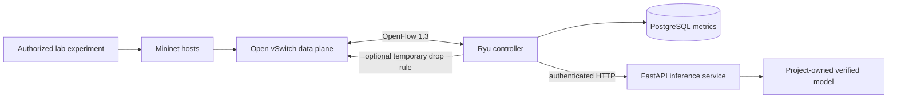

# Architecture

## Current baseline

- The topology has three access switches, one core switch, and nine hosts across three private segments.
- Ryu exposes an OpenFlow 1.3 application that learns MAC addresses, installs forwarding rules, and polls flow/port statistics every five seconds.
- The inference API receives six flow features: packet count, byte count, packet rate, byte rate, IP protocol, and destination L4 port.
- PostgreSQL stores flow, port, controller-resource, attack-window, detection, and mitigation events.
- The controller records detections and only installs temporary source-IP drop rules when `SDN_MITIGATION_ENABLED=true`.

## Boundaries

The optional [graphical workspace](lab-workspace.md) adds a local authenticated
web/API service, a separately authenticated privileged Mininet runner, and the
existing inference service in containers. The runner owns topology/process
lifetime, publishes bounded observations, and records projects/runs/events in
the existing PostgreSQL database. Browser replay reads those records only.
The original topology and six-feature model contract are unchanged. GUI runs
tag legacy controller metrics with a nullable `run_id`; CLI runs without it
retain the original insert contract. Schema changes are an explicit migration.

Controller telemetry uses a nonblocking Unix datagram socket, while existing
metric persistence remains independent. Link rates use elapsed-time counter
deltas (roughly one second); controller/model sampling keeps its original
interval. Queues are bounded and missing observations are reported. A recorder
failure stops the run; a cleanup failure prevents another run until the runner
container is recreated.

The controller does not infer authorization, discover targets, or download threat data. Configuration is supplied through environment variables. The inference service does not accept arbitrary model files without a checksum. Experiment traffic is generated only by an explicit bounded command in an isolated namespace.

## Data lifecycle

1. Open vSwitch reports flow and port counters to the controller.
2. The controller computes counter deltas and rates from the flow's own OpenFlow age (`duration_sec` + `duration_nsec`), ignoring the first sample. If the age or a counter goes down, the rule was replaced and that sample starts a new baseline. The controller's processing delay is not the rate clock. Port byte rates still use the time between port-stats replies.
3. Complete samples are sent in bounded batches to `/predict` when an API key is configured.
4. Predictions, flow rows, and resource metrics are persisted in UTC.
5. Detection is logged. Mitigation is separately guarded and auditable.
