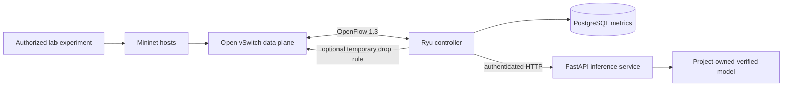

# Architecture

## Current baseline

- The topology has three access switches, one core switch, and nine hosts across three private segments.
- Ryu exposes an OpenFlow 1.3 application that learns MAC addresses, installs forwarding rules, and polls flow/port statistics every five seconds.
- The inference API receives six flow features: packet count, byte count, packet rate, byte rate, IP protocol, and destination L4 port.
- PostgreSQL stores flow, port, controller-resource, attack-window, detection, and mitigation events.
- The controller records detections and only installs temporary source-IP drop rules when `SDN_MITIGATION_ENABLED=true`.

## Boundaries

The controller does not infer authorization, discover targets, or download threat data. Configuration is supplied through environment variables. The inference service does not accept arbitrary model files without a checksum. Experiment traffic is generated only by an explicit bounded command in an isolated namespace.

## Data lifecycle

1. Open vSwitch reports flow and port counters to the controller.
2. The controller computes counter deltas and rates, ignoring the first sample and treating counter resets as a new baseline.
3. Complete samples are sent in bounded batches to `/predict` when an API key is configured.
4. Predictions, flow rows, and resource metrics are persisted in UTC.
5. Detection is logged. Mitigation is separately guarded and auditable.
